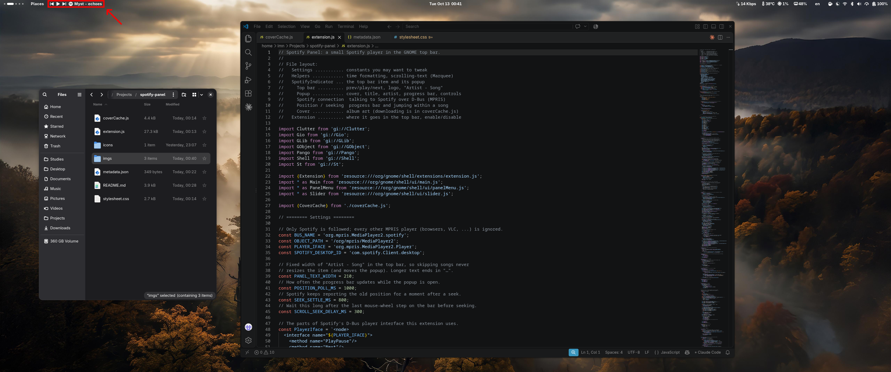
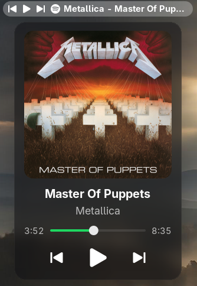
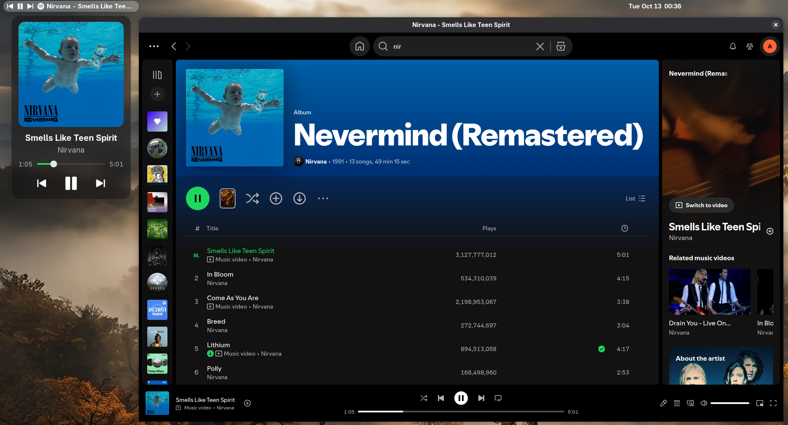

# Spotify Panel

A small Spotify player for the GNOME Shell top bar.



The top bar shows the media buttons, a white Spotify logo and the song as **Artist - Song**:

```
⏮ ⏸ ⏭  [Spotify logo]  Metallica - Master Of Puppets
```

Click the logo or the text to open a mini player with:

- the album cover
- the song title (scrolls if it's too long) and the artist
- a progress bar with the elapsed time and the song length; drag it to jump within the song
- previous / play-pause / next buttons

<p align="center">
  
  &nbsp;
  
</p>

## Features

- **Spotify only.** Other media players, like YouTube in a browser or VLC, are ignored.
- **Hidden when Spotify is closed.** It appears as soon as Spotify starts playing.
- **Fixed width.** The top bar item stays the same size whatever is playing, so the popup never jumps around. Long names end with "…" and scroll in full when you hover over them.
- **Click the cover or title** in the popup to bring the Spotify window to the front, the same as clicking Spotify in the dash.
- **Spotify-green** progress bar.
- **Blurred popup** if you use [Blur my Shell](https://extensions.gnome.org/extension/3193/blur-my-shell/) with popup blur turned on. This extension uses a standard GNOME popup, so Blur my Shell treats it like any other menu.
- **Light on resources.** See [How it works](#how-it-works).

## Requirements

- GNOME Shell 50
- The Spotify desktop app. It's tested with the [Flathub version](https://flathub.org/apps/com.spotify.Client), but any version works because it talks to Spotify through the standard Linux media player interface (MPRIS).

## Install

```bash
git clone https://github.com/AymanLauz/spotify-panel.git \
    ~/.local/share/gnome-shell/extensions/spotify-panel@imn
```

The folder must be named `spotify-panel@imn`.

Then **log out and back in**. On Wayland, GNOME only finds new extensions when you log in. Turn it on in the Extensions app or [Extension Manager](https://flathub.org/apps/com.mattjakeman.ExtensionManager), or with:

```bash
gnome-extensions enable spotify-panel@imn
```

The item appears on the left side of the top bar, right after the Places menu if you have it.

## Settings

There's no settings window. A few values at the top of `extension.js` can be changed:

| Setting | Default | What it does |
|---|---|---|
| `PANEL_TEXT_WIDTH` | `210` | Width in pixels of "Artist - Song" in the top bar |
| `POSITION_POLL_MS` | `1000` | How often the progress bar updates while the popup is open |

Colors and sizes are in `stylesheet.css`.

After editing, log out and back in for the changes to take effect.

## How it works

- **The top bar item** waits for Spotify to report changes (new song, play/pause, Spotify opened or closed). There are no timers, so when you're not looking at the popup it does no work.
- **The progress bar** is the only thing that checks with Spotify regularly, once a second. It only does this while the popup is open and a song is playing, because Spotify doesn't announce where it is in the song.
- **Album covers** are only downloaded when you open the popup. They're saved in `~/.cache/spotify-panel/` so they aren't downloaded again, even after a reboot. The folder is capped at 8 MB (about 70 covers), and the least recently viewed covers are deleted first. It's safe to delete the folder at any time.

## Files

| File | Contents |
|---|---|
| `extension.js` | The top bar item, the popup, and the connection to Spotify |
| `coverCache.js` | Downloading and caching album covers |
| `stylesheet.css` | Colors, sizes and spacing |
| `icons/spotify-symbolic.svg` | The one-color Spotify logo |
| `metadata.json` | Extension name, ID and supported GNOME version |

## Uninstall

```bash
gnome-extensions disable spotify-panel@imn
rm -rf ~/.local/share/gnome-shell/extensions/spotify-panel@imn ~/.cache/spotify-panel
```

---

Not affiliated with or endorsed by Spotify. Spotify is a trademark of Spotify AB.
